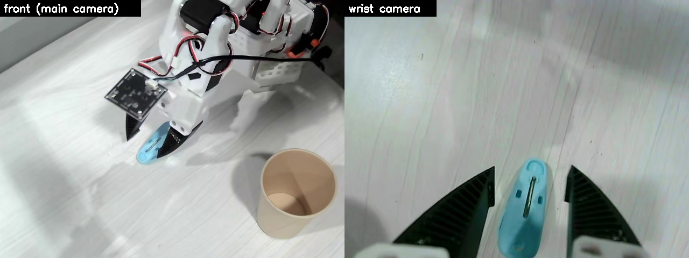
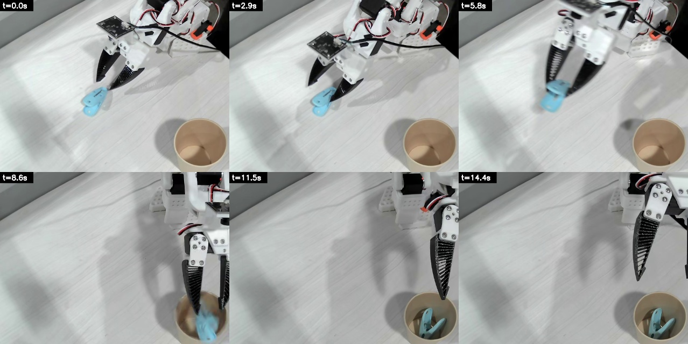
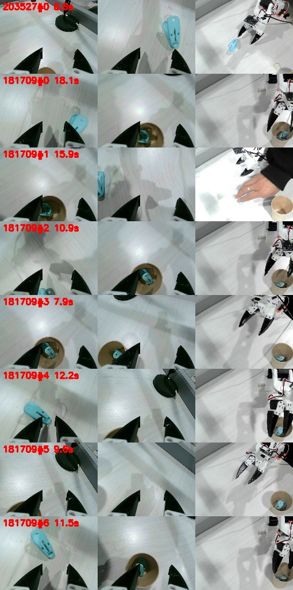
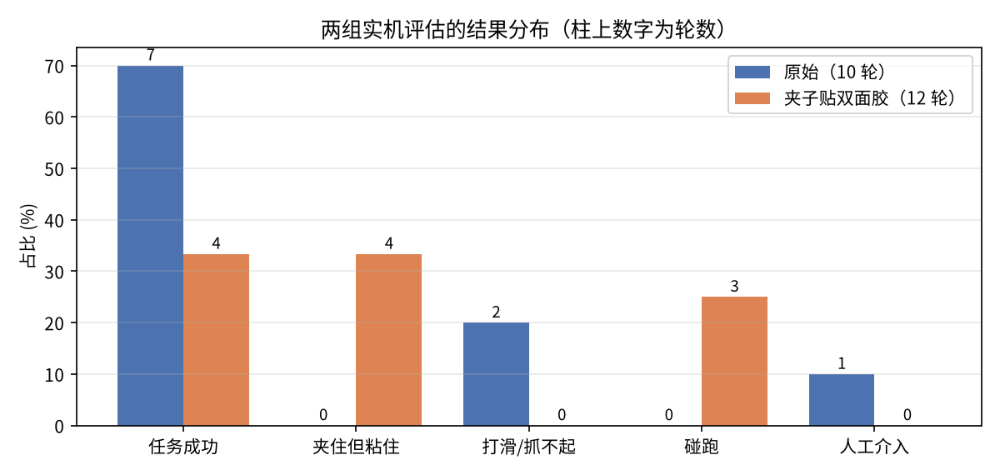
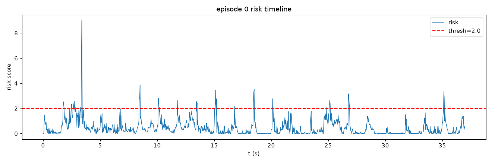
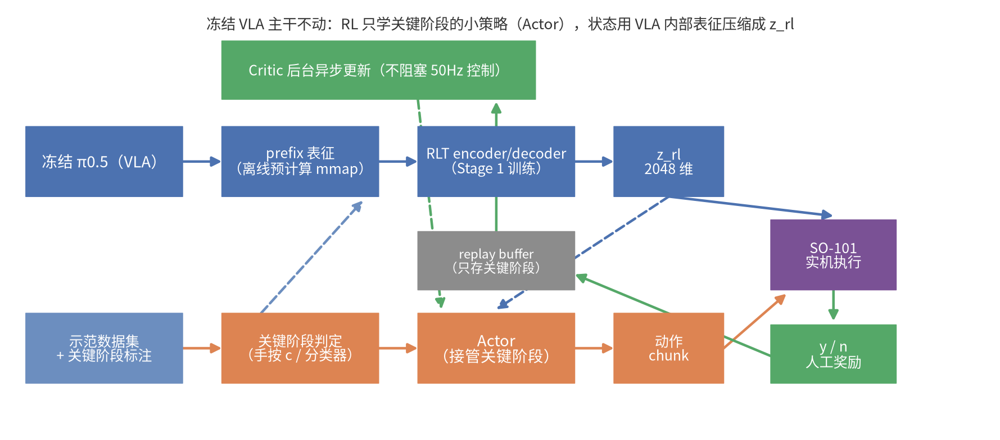

# SO-101 机械臂 + LeRobot 微调 π0.5 

用低成本 SO-101 主从机械臂走通「采集数据 → 微调 π0.5 → 实机部署 → 失败恢复」完整流程的完整记录。

## 内容

- **`SO101机械臂微调π0.5学习记录.docx`**：完整学习记录文档（Word 格式，含图）
- **`COMMANDS.md`**：全流程命令清单（安装、标定、采集、清洗、训练、部署、DAgger）
- **`RL_TOKEN.md`**：RL Token 在线强化学习部分（参考 RL-Token-Pi05，路径已适配本项目），含预计算表征、RLT 训练、关键阶段分类器、实机在线 RL 与部署命令
- **`images/`**：文档中用到的全部图片（训练数据、推理对比、评估截图、DAgger 数据检查图等）
- **`code/`**：自写脚本
  - `dagger_with_home.py`：DAgger 启动器，加了一键回 home 位
  - `merge_dagger.py`：原示范 + DAgger 纠正合并脚本（含坏样本剔除清单）
  - `preview.py`：按 episode 生成首尾帧拼图，用于数据检查
  - `make_docx.py`：Word 学习记录生成脚本
  - `make_figures.py` / `make_figures2.py`：文档配图生成

## 项目概要

| 项目 | 结果 |
|---|---|
| 任务 | Put the clip into the cup（把夹子放进纸杯） |
| 示范数据 | 50 条遥操作示范，18474 帧，30 fps，双相机 640×480 |
| 模型 | π0.5（pi05_base，约 41 亿参数），只训练动作专家（6.9 亿） |
| 训练 | RTX 4090 24GB 单卡，6000 步，batch 16，约 5 小时 |
| 实机评估 | 10 轮自主运行 7 轮成功 |
| 失败恢复 | DAgger 接管纠正 29 条，清洗后 23 条并入；第一轮占比过高成功率反降，第二轮干净配比重训后复评 20 轮 17 成功（85%），并保留失败后自我纠正 |
| 在线强化学习 | RL Token：冻结 π0.5 提取 z_rl 作状态，关键阶段 Actor 接管、Critic 异步更新，人工 y/n 奖励；拧螺栓任务在线训练 30 回合后 3/10 → 8/10（见 RL_TOKEN.md） |

## 实拍记录

| 硬件与相机 | 实机评估 | DAgger 数据检查 |
|---|---|---|
|  |  |  |

| 评估结果分布 | 动作级安全监控风险曲线 | RL Token 架构 |
|---|---|---|
|  |  |  |

## 文档目录

1. 项目背景与目标
2. 硬件与软件环境
3. 环境搭建（含国内网络踩坑）
4. 机械臂连接与标定
5. 相机配置
6. 数据采集与清洗（含采集注意事项）
7. 模型微调（含 π0.5 模型简介）
8. 实机部署与评估
9. 问题分析（覆盖范围、打滑、分布偏移）
10. 失败后自我调整：n_action_steps / RTC / DAgger 三种方法
11. 摩擦改进实验
12. 在线强化学习：RL Token（拧螺栓）
13. 踩坑汇总
14. 下一步计划
15. 参考资料
